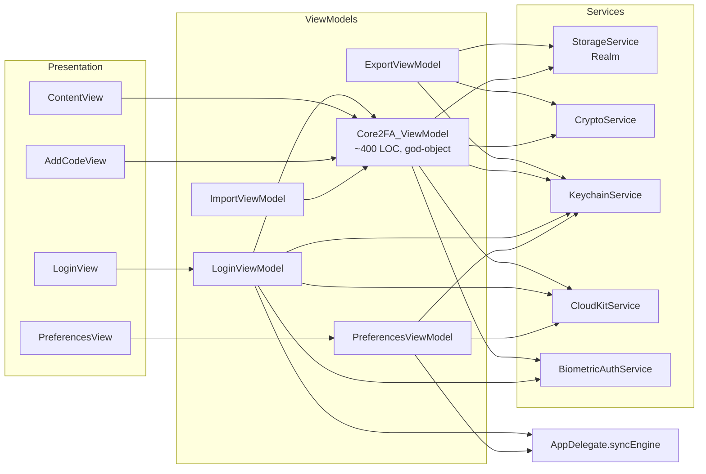
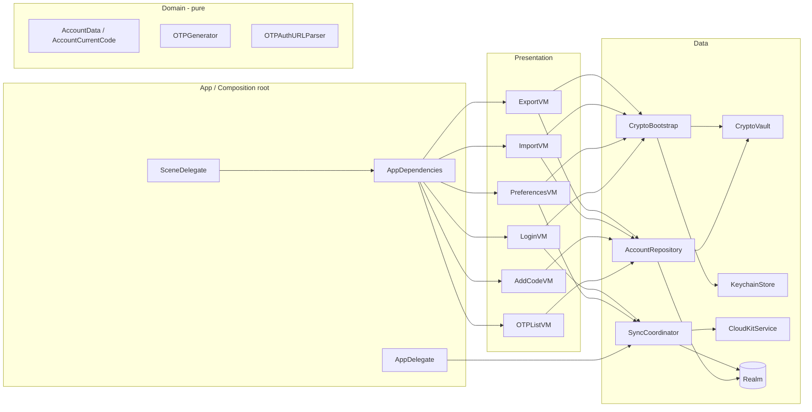

## Текущая архитектура и ключевые проблемы



Ключевые проблемы (по файлам):

- `Core2FA_ViewModel` ([open2fa/ViewModels/Core2FA_ViewModel.swift](open2fa/ViewModels/Core2FA_ViewModel.swift)) совмещает: OTP-генерацию + таймер, CRUD аккаунтов, маппинг крипто, бутстрап Salt/IV/KVC, биометрию, lifecycle-обсерверы UIApplication, GAuth-импорт, статические `isPasswordValid` / `isKeyValid` / `saveKVC` / `TestModel`.
- Бутстрап Salt/IV/KVC дублируется **4 раза**: `init?(password:)`, `isPasswordValid`, `isKeyValid`, `TestModel`.
- Доступ к синхронизации через `UIApplication.shared.delegate as! AppDelegate` из трёх ViewModel ([Core2FA_ViewModel.swift:234](open2fa/ViewModels/Core2FA_ViewModel.swift), [LoginViewModel.swift:71,100](open2fa/ViewModels/LoginViewModel.swift), [PreferencesViewModel.swift:62,72](open2fa/ViewModels/PreferencesViewModel.swift)) — silver bullet для тестов и стабильности.
- Маппинг `AccountData ↔ AccountObject` сидит в моделях ([AccountData.swift:40](open2fa/Models/AccountData.swift), [AccountModel.swift:23](open2fa/Models/AccountModel.swift)) и тянет за собой `CryptoService` — слой Data «утёк» в Domain.
- Декрипт всех записей выполняется на MainActor (`// Maybe move decryption to background thread?` — TODO в `Core2FA_ViewModel.updateAccounts()`).
- Singletons (`.shared`) + force-unwrap (`storage.realm!.observe`, `try!` в `O2FADocument.fileWrapper`, `as! AppDelegate`) делают код хрупким и нетестируемым.
- Парсинг `otpauth://` сидит прямо во View ([AddCodeView.swift:164-222](open2fa/Views/AddCodeView.swift)) — невозможно протестировать.
- Legacy: `Models/tmp_core2fa.swift` (имя «tmp_»), `CodesFile_legacy` в `O2FADocument`, hardcoded `core_version: "7.0.0"`.
- Тестов нет вообще.

## Целевая архитектура

Без введения новых фреймворков, тот же Realm + IceCream + CloudKit, но чёткие границы:



Ответственности:

- **`CryptoBootstrap`** — единый владелец логики Salt/IV/KVC: `password -> CryptoVault`, `validatePassword`, `validateKey`, инициализация KVC. Заменяет 4 дубля в `Core2FA_ViewModel`.
- **`CryptoVault`** — `encrypt(_: Data) / decrypt(_: Data)` с уже выведенным ключом; владеет жизненным циклом мастер-ключа (zeroing на logout).
- **`AccountRepository`** — единственный, кто знает про `AccountObject` и крипто-маппинг. API: `observe(_: ([AccountData]) -> Void)`, `add`, `update`, `delete(id:)`, `fetchAll() async`, `importAll(_:)`. Декрипт уезжает на фоновый поток (actor или DispatchQueue + thread-confined Realm).
- **`SyncCoordinator`** — единственный, кто создаёт/уничтожает `SyncEngine`, делает `push/pull`, грузит `PublicEncryptData` в CloudKit. Заменяет 3 места, где сейчас прямой доступ к `AppDelegate.syncEngine`.
- **`OTPListViewModel`** (бывший `Core2FA_ViewModel`) — только: таймер, `[AccountCurrentCode]`, подписка на репозиторий, реакция на `scenePhase`.
- **`AppDependencies`** — лёгкий контейнер (`final class`) c фабриками; передаётся через `.environmentObject` или `@Environment`. Заменяет `.shared`-доступы в новом коде.

## План работ (фазы)

Каждая фаза — отдельный коммит/PR, тестируемая, обратимая, без слома .o2fa и Realm-схемы.

### Фаза 1. Cleanup и quick safety
- Удалить/переименовать `Models/tmp_core2fa.swift` → `Models/LegacyAccountData.swift`, оставить только `CoreOpen2FA_AccountData` для миграции импорта.
- Заменить `try!` на `throw` в [O2FADocument.fileWrapper](open2fa/Models/O2FADocument.swift) (строка 42).
- Убрать `storage.realm!.observe` force-unwrap в [Core2FA_ViewModel.swift:165](open2fa/ViewModels/Core2FA_ViewModel.swift) — `guard let realm = storage.realm`.
- Вынести `_debugPrint` из [LoginView.swift:12](open2fa/Views/LoginView.swift) в `Extensions/Debug.swift`.

### Фаза 2. `CryptoBootstrap` + `CryptoVault`
Файлы: новые `Services/CryptoBootstrap.swift`, `Services/CryptoVault.swift`.

- `CryptoVault` оборачивает существующий `CryptoService` (ключ + iv-конкретные encrypt/decrypt). На `dispose()` обнуляет `key: [UInt8]`.
- `CryptoBootstrap` имеет один путь инициализации:

```swift
enum CryptoBootstrap {
    static func loadOrCreatePublicMaterial() -> PublicEncryptMaterial // salt + iv_kvc
    static func validate(password: String) -> CryptoVault?
    static func validate(key: [UInt8]) -> CryptoVault?
    static func persistKVC(using vault: CryptoVault) // если ещё нет
}
```

Это удаляет дубликаты `isPasswordValid` / `isKeyValid` / `saveKVC` + бутстрап в `init?(password:)` ([Core2FA_ViewModel.swift:131-194, 290-364](open2fa/ViewModels/Core2FA_ViewModel.swift)).

`KeychainService` оставляем, но переименуем в `KeychainStore` (без singleton; единственный экземпляр будет в `AppDependencies`).

### Фаза 3. `AccountRepository`
Новый файл `Data/AccountRepository.swift`.

- Поглощает `AccountObject(_:cm:)` ([AccountModel.swift:23](open2fa/Models/AccountModel.swift)) и `AccountData.init?(_:cm:)` ([AccountData.swift:40](open2fa/Models/AccountData.swift)) — `AccountData` становится чистым value-типом без знания о крипто.
- API:

```swift
@MainActor
final class AccountRepository {
    var accountsPublisher: AnyPublisher<[AccountData], Never>
    func add(name: String, issuer: String, secret: Data) throws
    func update(id: String, name: String, issuer: String) throws
    func delete(id: String) throws
    func importAll(_ accounts: [AccountData]) throws
}
```

- Декрипт выполняется в `Task.detached` / на фоновой очереди, результат публикуется на Main.
- `Core2FA_ViewModel.fetchAccounts/updateAccounts/addAccount/editAccount/deleteService/importAccounts` → тонкие прокси к репозиторию (на этой фазе ещё не удаляем сам класс).

### Фаза 4. `SyncCoordinator`
Новый файл `Data/SyncCoordinator.swift`.

- Инкапсулирует `SyncEngine` lifecycle + `CloudKitService.uploadPublicEncryptData`/`deleteAllAccounts`/`deleteAllPublicEncryptData`.
- `AppDelegate.syncEngine` → `AppDependencies.sync.engine` (приватно).
- `AppDelegate` остаётся только маршрутизатором remote-notifications.
- Места замены: [LoginViewModel.swift:71,100](open2fa/ViewModels/LoginViewModel.swift), [PreferencesViewModel.swift:62,72](open2fa/ViewModels/PreferencesViewModel.swift), [Core2FA_ViewModel.swift:234](open2fa/ViewModels/Core2FA_ViewModel.swift).

### Фаза 5. Slim `Core2FA_ViewModel` → `OTPListViewModel`
- Оставить только: `@Published codes / progress / timeRemaining / isActive`, таймер, ребилд `codes` из `AccountRepository.accountsPublisher` и `OTPGenerator`.
- `OTPGenerator` — pure-функция над `[AccountData] -> [AccountCurrentCode]` (выделить из текущего `getOTPList()`).
- Lifecycle (lock/unlock по таймауту) → отдельный `AppLockController`, который слушает `scenePhase` (SwiftUI) вместо `UIApplication.willResignActiveNotification`. Биометрия запрашивается через инъекцируемый `BiometricAuthenticating`.
- Удалить `static var TestModel` — заменить `AccountRepository.previewMock` + `OTPListViewModel.preview`.

### Фаза 6. `AppDependencies` (DI)
Новый файл `App/AppDependencies.swift`:

```swift
final class AppDependencies: ObservableObject {
    let keychain: KeychainStore
    let cryptoBootstrap: CryptoBootstrap.Type
    let sync: SyncCoordinator
    let biometric: BiometricAuthenticating
    func makeAccountRepository(vault: CryptoVault) -> AccountRepository
}
```

- `SceneDelegate` создаёт один экземпляр и кладёт через `.environmentObject(deps)` в корневую `LoginView`.
- ViewModels принимают зависимости через `init(deps:)`, без `.shared` в новом коде. `KeychainService.shared` остаётся как фасад временно, но новые места только через DI.

### Фаза 7. Чистка Views и парсер OTP
- Вынести парсинг `otpauth://totp/...` из [AddCodeView.swift:164-222](open2fa/Views/AddCodeView.swift) в `Domain/OTPAuthURLParser.swift` (struct + unit-tests).
- `AddCodeView` через новую `AddCodeViewModel`, без прямого вызова `core.addAccount/importFromGAuth`.
- В `ContentView` починить опечатку `onReceive` без точки на [ContentView.swift:48](open2fa/Views/ContentView.swift).

### Фаза 8. Unit-тесты (критичная часть)
Цель — покрыть зоны, где была дублирующаяся / опасная логика:

- `CryptoVaultTests` — encrypt/decrypt round-trip, неправильный IV/ключ.
- `CryptoBootstrapTests` — bootstrap из пустого Keychain, валидация правильного/неправильного пароля, идемпотентность KVC.
- `AccountRepositoryTests` — in-memory Realm (`Realm.Configuration(inMemoryIdentifier:)`), CRUD + soft-delete + observe.
- `OTPGeneratorTests` — детерминированный TOTP по фиксированному времени.
- `OTPAuthURLParserTests` — `otpauth://totp/Issuer:Name?secret=...&issuer=...`, URL-encoded имена, hotp (must throw), `otpauth-migration://...` (delegate в `GAuthDecrypt`).

### Фаза 9. Документация в `/docs/ai/`
Создать минимальный набор согласно user-rule:

- `docs/ai/index.md` — оглавление.
- `docs/ai/architecture.md` — итоговая диаграмма + ответственности слоёв.
- `docs/ai/conventions.md` — naming (camelCase для новых полей, `*ViewModel`, без `_` префиксов), DI через `AppDependencies`, запрет `.shared` в новом коде, запрет force-unwrap.
- `docs/ai/glossary.md` — KVC, Salt, IV, PublicEncryptData, SyncEngine, AccountObject vs AccountData.

## Что НЕ делаем (осознанные ограничения)

- Не мигрируем с Realm/IceCream на SwiftData — выходит за рамки «инкрементально».
- Не меняем формат `.o2fa` (`AccountsFileStruct`) и `CKRecord`-схему — обратная совместимость экспорт/импорт + iCloud.
- Не меняем PBKDF2-параметры и схему KVC в этом плане — это security-fix отдельной задачей с миграцией (отметил, чтобы не забыть: 4096 итераций — мало по современным меркам, KVC через random `AccountData` стоит заменить на HMAC; делать с миграцией KVC по версии).
- Не вводим Coordinator-pattern для навигации — SwiftUI NavigationLink остаётся.

## Порядок реализации и риски

1. Фазы 1 → 2 → 3 идут последовательно, каждая компилируется и работает.
2. Фаза 4 и 5 можно параллелить после фазы 3.
3. Фаза 6 — после 2–5.
4. Фаза 7 — независима, можно сделать раньше.
5. Тесты (фаза 8) пишутся вместе с фазами 2, 3, 7.

Главные риски и митигация:
- **Realm thread-confinement** при переносе декрипта на фон — использовать `ThreadSafeReference` или открыть Realm на background actor; покрыть тестом.
- **iCloud SyncEngine** — `IceCream` чувствителен к порядку init/teardown; покрыть smoke-checks вручную (включить sync → создать → выключить → включить).
- **Регрессии экспорта/импорта** — после фазы 2 прогнать ручной сценарий import legacy `CodesFile_legacy` + новый `AccountsFileStruct`.